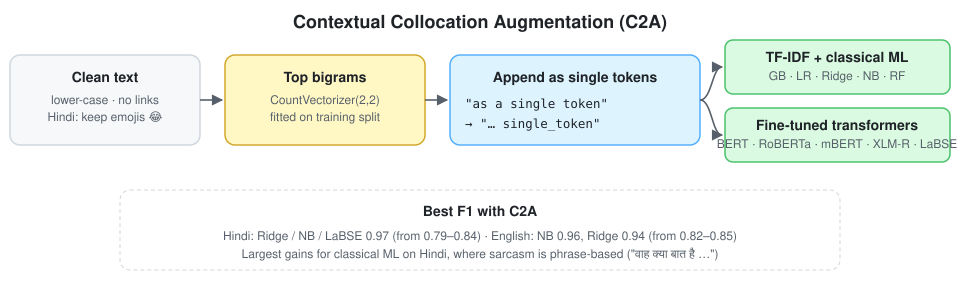

<div align="center">

# Interpretable Sarcasm Detection via Contextual Collocation Augmentation (C2A)
### From word pairs to context: English news headlines and Hindi tweets

[%20447--454-1f6feb)](https://doi.org/10.1016/j.procs.2026.01.054)
[](https://doi.org/10.1016/j.procs.2026.01.054)
[](#installation)
[](LICENSE)
[](https://github.com/marif561/Interpretable_Sarcasm_Detection/actions/workflows/tests.yml)

Code and results for **"From Word Pairs to Context: Interpretable Sarcasm Detection via Contextual Collocation Augmentation (C2A)"**, *Procedia Computer Science* 275 (2026) 447–454, 7th International Conference on AI in Computational Linguistics (ACLing 2025). Open access (CC BY-NC-ND 4.0).

Abiola T. O. · **Muhammad Arif** · Oredeko O. B. · Obiadoh A. E. · Tewodros A. B. · Ojo O. E. · Carlos Guzmán Sánchez-Mejorada · G. Sidorov · C. E. Maldonado-Sifuentes · Calvo H.

*Instituto Politécnico Nacional (CIC-IPN), Mexico · Covenant University, Nigeria · University of Sunderland, UK · Colorado State University, USA*

</div>

---

## About the paper

Sarcasm is hard to detect in text. Without tone of voice or facial expression, the cue is often a **fixed phrase** such as *"oh great, another…"* or *"वाह क्या बात है"* ("wow, how wonderful"). **C2A** is a lightweight, language-independent augmentation step that makes these phrases explicit. It finds the most frequent **bigram collocations** in the training data and appends each one found in a text as a **single token** (*"as a single token"* → *"… single_token"*). Classical models and transformers can then use the whole phrase as a feature.

Tested on **English news headlines** and **Hindi tweets**, C2A lifts classical models (Ridge, Logistic Regression, Naïve Bayes) to **0.94–0.97 F1**. That beats several deep-learning approaches and comes close to fine-tuned transformers at a fraction of the cost. It also improves transformers, most clearly on Hindi, where mBERT, XLM-RoBERTa and LaBSE go from about 0.83 to **0.95–0.97 F1**. This fits the finding that Hindi sarcasm is especially phrase-based. Because the added features are readable word pairs, the models stay **interpretable**.

<p align="center">
  
</p>

## Datasets

| Dataset | Language | Unique samples | Sarcastic | Not sarcastic | Columns |
|---|---|---:|---:|---:|---|
| News Headlines Dataset for Sarcasm Detection (Misra & Arora), Hugging Face / Kaggle | English | 28,607 | 13,633 | 14,984 | `headline`, `is_sarcastic` |
| Sarcasm-labelled Hindi Twitter corpus, Kaggle | Hindi | 19,955 | 9,962 | 9,962 | `hindi_text`, `is_sarcastic` |

The data is split 80 / 20 into train and test with `train_test_split` (seed 42). The Hindi class counts are as printed in the paper; they add up to 19,924, slightly less than the 19,955 total. See [`data/README.md`](data/README.md).

## Method

1. **Clean.** Lower-case the text and remove links and non-alphanumeric characters. For Hindi, **emojis are kept** because they are sarcasm cues.
2. **C2A.** Take the top bigrams from `CountVectorizer(ngram_range=(2, 2))` on the training split and append the ones present in each text as single tokens:
   $$\text{TF-IDF}_{aug}(t,d) = \text{TF-IDF}(t,d) + \sum_{b \in B_d} \text{TF-IDF}(b,d)$$
3. **Classify.**
   - **Classical ML** on TF-IDF: Gradient Boosting, Logistic Regression, Ridge, Naïve Bayes and Random Forest.
   - **Transformers**, fine-tuned on the same augmented text: BERT, RoBERTa and DistilBERT for English; mBERT, XLM-RoBERTa and LaBSE for Hindi.
4. **Evaluate.**
   - per-class precision, recall and F1
   - ROC-AUC and precision–recall curves
   - confusion matrices
   - a list of misclassified samples for error analysis

## Results

### Classical ML: per-class F1, TF-IDF → C2A + TF-IDF (Table 1)

| Model | English 0 | English 1 | Hindi 0 | Hindi 1 |
|---|:-:|:-:|:-:|:-:|
| Gradient Boosting | 0.72 → 0.75 | 0.77 → 0.79 | 0.78 → 0.84 | 0.74 → 0.82 |
| Logistic Regression | 0.84 → 0.92 | 0.83 → 0.91 | 0.80 → **0.96** | 0.79 → **0.96** |
| Ridge | 0.85 → 0.94 | 0.84 → 0.94 | 0.82 → **0.97** | 0.81 → **0.97** |
| Naïve Bayes | 0.85 → **0.96** | 0.82 → **0.95** | 0.74 → **0.97** | 0.79 → **0.97** |
| Random Forest | 0.81 → 0.87 | 0.80 → 0.86 | 0.84 → 0.95 | 0.84 → 0.95 |

### Transformers: per-class F1, without → with C2A (Table 2)

| Language | Model | Class 0 | Class 1 |
|---|---|:-:|:-:|
| English | BERT | 0.94 → **0.95** | 0.93 → **0.94** |
| English | RoBERTa | 0.94 → 0.94 | 0.93 → 0.94 |
| English | DistilBERT | 0.93 → 0.94 | 0.93 → 0.94 |
| Hindi | mBERT | 0.83 → 0.96 | 0.84 → 0.96 |
| Hindi | XLM-RoBERTa | 0.82 → 0.95 | 0.83 → 0.95 |
| Hindi | LaBSE | 0.83 → **0.97** | 0.84 → **0.97** |

Precision and recall for every cell, plus the comparison with earlier work (Table 3), are in [`results/`](results/).

**Takeaways**

- C2A helps every model, and helps **classical ML most**: with explicit collocations, a linear model on TF-IDF reaches transformer-level F1 on Hindi.
- **Hindi gains more than English.** Hindi sarcasm relies on set phrases and emojis, which C2A turns into explicit features.
- On Hindi the transformer gains come mostly from **recall**. For example, mBERT's class-0 recall rises from 0.78 to 0.96. English transformers change little, because self-attention already captures much of the context.
- The features are **readable**. `train_ml` writes the collocations most associated with sarcasm (`top_collocations.csv`), which makes the model easy to inspect.

## Repository structure

```
.
├── data/                    # Data guide + invented English/Hindi samples
├── docs/figures/            # C2A diagram
├── results/                 # Paper tables as CSV
├── scripts/                 # run_all.sh, plot_curves.py (ROC / PR figures)
├── tests/                   # Unit + end-to-end tests (CI on every push)
└── src/c2a/
    ├── preprocess.py        # English / Hindi cleaning (emojis kept for Hindi)
    ├── augment.py           # CollocationAugmenter: fit top bigrams, append as tokens, explain()
    ├── data.py              # Loading, de-duplication, 80/20 split (seed 42)
    ├── metrics.py           # Per-class P/R/F1, ROC-AUC, curves, misclassified samples
    ├── train_ml.py          # GB / LR / Ridge / NB / RF with and without C2A
    └── train_transformer.py # BERT-family fine-tuning with and without C2A
```

## Installation

```bash
git clone https://github.com/marif561/Interpretable_Sarcasm_Detection.git
cd Interpretable_Sarcasm_Detection
python -m venv .venv && source .venv/bin/activate
pip install -e ".[transformers,plots]"
```

## Usage

```bash
# Classical ML, TF-IDF vs. C2A + TF-IDF (Table 1)
python -m c2a.train_ml --data Sarcasm_Headlines_Dataset_v2.json --lang en
python -m c2a.train_ml --data hindi_sarcasm.csv --lang hi

# Transformers without and with C2A (Table 2)
python -m c2a.train_transformer --data hindi_sarcasm.csv --lang hi --model sentence-transformers/LaBSE
python -m c2a.train_transformer --data hindi_sarcasm.csv --lang hi --model sentence-transformers/LaBSE --c2a

# ROC and precision-recall curves
python scripts/plot_curves.py outputs/ml

# Everything
bash scripts/run_all.sh Sarcasm_Headlines_Dataset_v2.json hindi_sarcasm.csv
```

Use C2A in your own pipeline:

```python
from sklearn.pipeline import make_pipeline
from sklearn.feature_extraction.text import TfidfVectorizer
from sklearn.linear_model import RidgeClassifier
from c2a import CollocationAugmenter
from c2a.augment import TOKEN_PATTERN

model = make_pipeline(CollocationAugmenter(top_k=1000),
                      TfidfVectorizer(token_pattern=TOKEN_PATTERN),
                      RidgeClassifier())
model.fit(train_texts, train_labels)
```

> **Note.** `src/` is a clean, tested re-implementation of the method described in the paper. Some settings aren't given in the paper:
> - the number of collocations: `--top-k`, default 1000
> - the transformer fine-tuning settings: defaults lr 2e-5, batch 16, 3 epochs, max length 128
>
> These use common values and are marked in the code. The paper writes the loss as binary cross-entropy. The transformers here use the equivalent two-class softmax cross-entropy.

## Citation

```bibtex
@article{abiola2026c2a,
  title   = {From Word Pairs to Context: Interpretable Sarcasm Detection via Contextual Collocation Augmentation ({C2A})},
  author  = {Abiola, T. O. and Arif, Muhammad and Oredeko, O. B. and Obiadoh, A. E. and Tewodros, A. B. and
             Ojo, O. E. and S{\'a}nchez-Mejorada, Carlos Guzm{\'a}n and Sidorov, G. and
             Maldonado-Sifuentes, C. E. and Calvo, H.},
  journal = {Procedia Computer Science},
  volume  = {275},
  pages   = {447--454},
  year    = {2026},
  doi     = {10.1016/j.procs.2026.01.054},
  note    = {7th International Conference on AI in Computational Linguistics (ACLing 2025)}
}
```

## License

Code is released under the [MIT License](LICENSE). The article is open access under CC BY-NC-ND 4.0. The datasets are subject to their own licences on Hugging Face and Kaggle.
